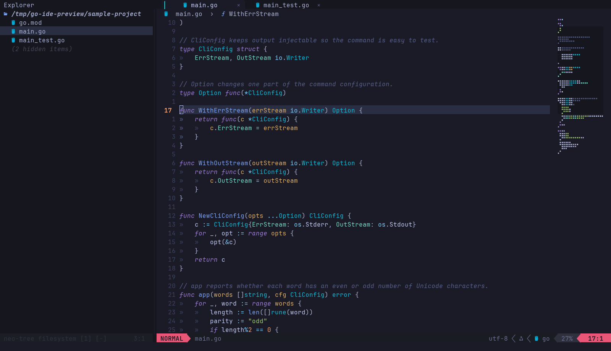

# Neovim Go IDE

A complete, isolated Neovim profile for daily Go development. It combines the
navy palette, italic syntax, relative numbers, and status line of your current
Neovim screenshot with the Go IDE workflow built for this package. Start it
with `nvim-go`.

## Preview

<p align="center">
  
</p>

<p align="center">
  
</p>

The full-resolution screenshot above is the visual reference. The smaller
animation is a quick tour built from the repository's original PNG captures,
with a separate palette per frame and dithering disabled to keep terminal text
crisp. Font rasterization and terminal chrome can still differ slightly between
Linux and macOS.

## Install on Fedora Asahi Remix

Clone the repository, then install from its root directory:

```bash
sudo dnf install git curl tar unzip gcc ripgrep wl-clipboard fontconfig
git clone https://github.com/zaouldyeck/nvim-go-ide.git
cd nvim-go-ide
bash install.sh --font
bash scripts/check.sh ~/.local/bin/nvim-go
cd sample-project
~/.local/bin/nvim-go main.go
```

Select **JetBrainsMono Nerd Font Mono** in your terminal's font settings.
The optional font installer does not change your selected terminal font.
The installer needs internet access and a C compiler for the syntax parsers.
It selects native Linux ARM64 binaries on Fedora Asahi. Linux x86_64 and macOS
ARM64/x86_64 paths are also included; Linux x86_64 was the execution test host.

For your own project:

```bash
cd ~/code/golang/cli
~/.local/bin/nvim-go .
```

## Install on macOS

The primary macOS path targets **Apple Silicon** on current macOS. As of October
2026, the latest release is macOS Golden Gate 27.x. The commands below are
version-agnostic and use the repository's own pinned Neovim and Go toolchain.

Install Apple's Command Line Tools, then install Homebrew and `ripgrep` if
needed:

```bash
xcode-select --install

# If Homebrew is not already installed:
# /bin/bash -c "$(curl -fsSL https://raw.githubusercontent.com/Homebrew/install/HEAD/install.sh)"
# Follow Homebrew's printed shellenv instructions, then:
brew install ripgrep
```

Clone and install the profile:

```bash
git clone https://github.com/zaouldyeck/nvim-go-ide.git
cd nvim-go-ide
bash install.sh --font
bash scripts/check.sh ~/.local/bin/nvim-go
cd sample-project
~/.local/bin/nvim-go main.go
```

The installer automatically selects the native macOS ARM64 Neovim archive on
Apple Silicon and installs the Nerd Font under `~/Library/Fonts`. Select
**JetBrainsMono Nerd Font Mono** in your terminal and reopen the terminal before
judging the layout. Keep the terminal at roughly **140 columns or wider** if you
want the minimap visible by default.

For the closest visual match, use an opaque true-colour terminal. Ghostty,
iTerm2 and Terminal.app all work; Ghostty-specific font settings are documented
in [the macOS setup guide](docs/MACOS.md).

macOS already provides `pbcopy`/`pbpaste`, which Neovim can use as its system
clipboard provider, so no `wl-clipboard` equivalent is required.

For the full macOS walkthrough, appearance settings, verification steps and
troubleshooting, see [docs/MACOS.md](docs/MACOS.md).

## What is included

| Area | Features |
| --- | --- |
| Appearance | Screenshot-sampled navy palette, italic purple keywords, cyan Go gophers, native rounded-card tabs, breadcrumbs, sticky code context, responsive Explorer/minimap, polished completion and floats, and the original Horizon per-pane status bars |
| Navigation | Neo-tree Explorer, Flash label jumps, sticky Tree-sitter context, fuzzy search, outline, implementation/reference pickers, structural Go function/test motions, responsive layout and Focus Mode |
| Go editing | gopls with visible progress, icon-rich completion, current-line diagnostics, custom LuaSnip templates, rounded hover/signature cards, rename/code actions, imports/formatting, module tidy, inlay hints and code lenses |
| Execution | Run the current package interactively; nearest/file/package/module tests; exact rerun-last; persistent pass/fail/skip gutter state with timings; Quicker failure views; coverage markers |
| Debugging | Delve, breakpoints and conditional breakpoints, step/continue, locals, watches, call stacks, expression evaluation, nearest-test debugging, compatible Go launch.json entries |
| Daily workflow | Git gutter changes, hunk preview/staging/reset, blame, integrated shell, persistent undo, mouse support, discoverable Space-prefixed keys |
| Delivery | Installer, exact plugin lockfile, pinned native tool versions, sample CLI and tests, getting-started guide, shortcut reference, installation checker |

## IDE experience

The profile now adapts around the code instead of keeping every surface visible
all the time:

- **Sticky context** pins at most two enclosing Go type/function lines while you
  scroll. Jump back to that context with `[c`; toggle it with **Space u c**.
- **Current-line diagnostics** stay out of the way until your cursor lands on a
  problem, then show one compact message immediately below that source line.
- **gopls progress and notifications** use small rounded transient cards rather
  than disappearing into `:messages`.
- **Flash navigation** uses **s** for labeled jumps and **S** for syntax-tree
  selection. `]m` / `[m` move between Go functions and methods; `]t` / `[t`
  move between tests.
- **Focus Mode** (**Space u f**) temporarily hides Explorer, breadcrumbs,
  minimap and sticky context, then restores the exact previous layout.
- **Responsive layout** hides Explorer on narrow terminals and restores it when
  there is room again; the minimap remains width-aware.
- **Go tests remember state**: top-level tests receive ✓ / ✗ / ○ gutter markers
  and duration hints until package source changes. **Space t r** reruns the exact
  previous test command.
- **Quicker** presents failure locations with syntax/LSP highlighting and
  expandable context; use **Space x q**.
- Completion, Telescope, WhichKey, DAP floats and documentation cards share the
  same blue-grey rounded-border language. The existing Horizon statusbar is
  deliberately unchanged.

## Start here

- Read [the getting-started guide](docs/GETTING_STARTED.md).
- On macOS, follow [the macOS installation guide](docs/MACOS.md).
- Keep [the complete shortcut reference](docs/SHORTCUTS.md) nearby.
- Open the printable `nvim-go-getting-started.pdf` supplied with this package.
- Review [what was actually tested](docs/VALIDATION.md).

Inside Neovim, `:GoIdeGuide`, `:GoIdeSettings`, and `:GoIdeHealth` open the guide,
preferences, and diagnostics. Press **Esc**, then **Space** and pause to discover
the available actions. For example, **Space f f** finds a file and **Space t t**
runs the nearest test.

The default view keeps a GUI-editor style chrome: the file-tab strip is always
visible, breadcrumbs stay directly below it for file/symbol context, and the
minimap opens automatically on sufficiently wide editor windows. Use **Space u b**
to hide/show breadcrumbs, **Space m m** to toggle the minimap, and **Space u n**
to switch line number styles. Search, the symbol outline, tests, and debugging
remain available in this layout.

The row directly below the file tabs is reserved for editor context. By default
it contains breadcrumbs; hiding breadcrumbs leaves the same row blank, so the
first source line never presses against the tab strip. Set
`editor_top_padding = false` in `:GoIdeSettings` to remove the blank row when
breadcrumbs are disabled.

The main editor deliberately stays unframed. Neo-tree uses a slightly darker
panel background with no visible vertical divider. A native Neovim tabline hides
unnamed scratch buffers, lets inactive files blend into the top chrome, and uses
Nerd Font semicircle caps as real left/right edges around the active file.
Breadcrumbs sit on their own dark header strip below the
tabs, giving the editor the same breathing room without drawing lines through
the code area. When breadcrumbs are hidden, their row becomes the blank spacer
instead.

The rounded four-sided border used by documentation, signature help and other
floating cards remains reserved for floating windows; regular editing splits
cannot use Neovim's floating-window border API.

The Explorer is 34 columns wide. The minimap threshold is 140 terminal columns
so it is visible on the wide layout used in the screenshots. Its header keeps
the beginning of the directory
path, replacing your home directory with `~` when applicable. Press **H** inside
Explorer to show or hide filtered files, and **?** for its local key reference.
The original per-pane Horizon status bars are preserved, including the coloured
mode and location segments and Powerline separators shown in the existing setup.

Press **K** on a Go symbol for syntax-coloured documentation in a dark card
with a rounded blue border. Press **K** again to focus it, scroll with **j/k**
or **Ctrl+D / Ctrl+U**, and close it with **q** or **Esc**. Moving the cursor in
the source dismisses an unfocused card. **Ctrl+K** in Insert mode shows signature
help with the same border.

### Your familiar editing workflow

In a Go file, type `func` and press **Ctrl+L** to expand your function template.
Use **Ctrl+L / Ctrl+H** to move forward/back through its fields and
**Alt+N / Alt+P** while a return choice is active to select multiple returns,
a single return, or no return. These keys work in Insert and snippet Select
mode. **Tab** keeps its existing completion-first behavior. Snippet jumps also
work through argument placeholders created by gopls completion; they do not
move between arbitrary arguments in code that was already written.

Your `tys`/`struct`, `meth`, `func`, and `fmain`/`main` templates live in
`config/lua/custom/snippets.lua`, alongside the existing Go snippets. After
editing the installed module, run `:GoSnippetsReload`. The guide includes a
worked function example and explains how to keep personal edits on updates.

Your `Space s ...` search shortcuts are restored, including **Space s w** for
the current word, **Space s r** to resume a picker, and **Space /** to search
the current buffer. Existing `Space f ...` shortcuts remain available.
Use **Space c m** or `:GoModTidy` to run `go mod tidy` explicitly in the active
module. It runs asynchronously in the Go output panel; `:GoStop` cancels it.
Saving a Go file formats/imports the file and does not trigger module tidy.

## Installation and version choices

The default profile uses `~/.config/nvim-go` and `~/.local/share/nvim-go`, with a
launcher at `~/.local/bin/nvim-go`. Neovim's `NVIM_APPNAME` keeps its configuration,
plugins, state and cache separate from ordinary `nvim`.

The installer pins Neovim **0.11.7**, gopls **v0.24.0**, goimports from x/tools
**v0.52.0**, and Delve **v1.27.2**. If a suitable Go 1.27 toolchain is not already
available, it installs a private **Go 1.27.3** for this profile. `--install-go`
forces that private toolchain. These versions are recorded in
`scripts/versions.env`; the exact plugin commits are in `config/lazy-lock.json`.

Neovim 0.11.7 is intentionally paired with nvim-treesitter's frozen `master`
API and Aerial's `nvim-0.11` compatibility branch. Change the editor and related
plugin APIs together if you later migrate to a newer Neovim series. The
configuration avoids the deprecated `require('lspconfig').gopls.setup()` path.
Neo-tree's `v3.x` branch and its Nui dependency are pinned alongside the other
plugins; the installer restores the revisions in the lockfile, including the
Telescope dropdown selection extension.

To update an existing clone, save and close `nvim-go`, then run these commands
from the repository root. Commit or otherwise preserve any changes in the
clone before pulling:

```bash
git pull --ff-only
bash install.sh
bash scripts/check.sh ~/.local/bin/nvim-go
```

Pulling updates the checkout; running the installer applies it to your active
profile. Reinstalling creates timestamped configuration and launcher backups.
It replaces the installed configuration, so preserve and reapply personal
settings and custom snippets from the printed backup path. If you are using
the original ZIP, clone the repository first and run its installer; use
`--font` when you also need the font. The guide covers complete rollback and
the distinction between settings, executable tools, and plugin data.

## Configuration map

| File | Purpose |
| --- | --- |
| `config/init.lua` | Startup sequence |
| `config/lua/go_ide/settings.lua` | Common user preferences and colour palette |
| `config/lua/go_ide/theme.lua` | Syntax and UI highlight groups |
| `config/lua/go_ide/keymaps.lua` | Keyboard actions |
| `config/lua/go_ide/explorer.lua` | Shared Neo-tree open, toggle and reveal actions |
| `config/lua/go_ide/hover.lua` | Native documentation/signature cards, sizing, borders and local close keys |
| `config/lua/plugins/ui.lua` | Explorer, tabs, status line, search, outline, minimap, Git |
| `config/lua/plugins/go.lua` | Completion, snippets and debugger dependencies |
| `config/lua/custom/snippets.lua` | Personal Go templates and return-type choices; reload with `:GoSnippetsReload` |
| `config/lua/go_ide/lsp.lua` | gopls, formatting, imports and analysis |
| `config/lua/go_ide/go.lua` | Run, tests, module tidy, quickfix and coverage |
| `config/lua/go_ide/debug.lua` | Delve launch configurations and debugger panels |
| `config/lua/go_ide/terminal.lua` | Persistent project shell |
| `scripts/versions.env` | Tool versions and official release checksums |
| `scripts/check.sh` | Installation checks; no plugin installation in check mode |
| `scripts/build-guide-pdf.py` | Rebuild the printable guide from the tracked Markdown and screenshots |

### Rebuild the printable guide

The PDF contains the getting-started guide and the complete shortcut reference.
To rebuild it from the repository root:

```bash
python3 -m pip install reportlab matplotlib
python3 scripts/build-guide-pdf.py
```

These Python packages are only needed to build the documentation. They are
not needed to install or use the editor. The script writes
`nvim-go-getting-started.pdf`; `--output /path/to/guide.pdf` selects another
destination.

## Scope

This is a terminal-native Go IDE. Fonts, outer window chrome, terminal
transparency and your shell prompt are controlled by the terminal and shell.
The minimap uses terminal cells rather than VS Code's tiny pixel font.
VS Code's extension marketplace, Ports panel and arbitrary extension-specific
settings are not reproduced. Compatible Go debugging entries can be read from
`.vscode/launch.json`; VS Code tasks and extension commands need adaptation.

The package downloads third-party tools and plugins from their upstream sources;
their original licenses continue to apply. It does not bundle their binaries.

## Official references

- [Neovim 0.11.7](https://github.com/neovim/neovim/releases/tag/v0.11.7)
- [Neovim standard paths and NVIM_APPNAME](https://neovim.io/doc/user/starting/#standard-path)
- [gopls features](https://go.dev/gopls/features/)
- [nvim-dap-go](https://github.com/leoluz/nvim-dap-go)
- [lazy.nvim lockfiles](https://lazy.folke.io/usage/lockfile)
- [nvim-treesitter compatibility branch](https://github.com/nvim-treesitter/nvim-treesitter/tree/master)
- [Neo-tree v3.x](https://github.com/nvim-neo-tree/neo-tree.nvim/tree/v3.x)
- [lualine.nvim](https://github.com/nvim-lualine/lualine.nvim)
- [Neovim hover documentation](https://neovim.io/doc/user/lsp/#vim.lsp.buf.hover())
