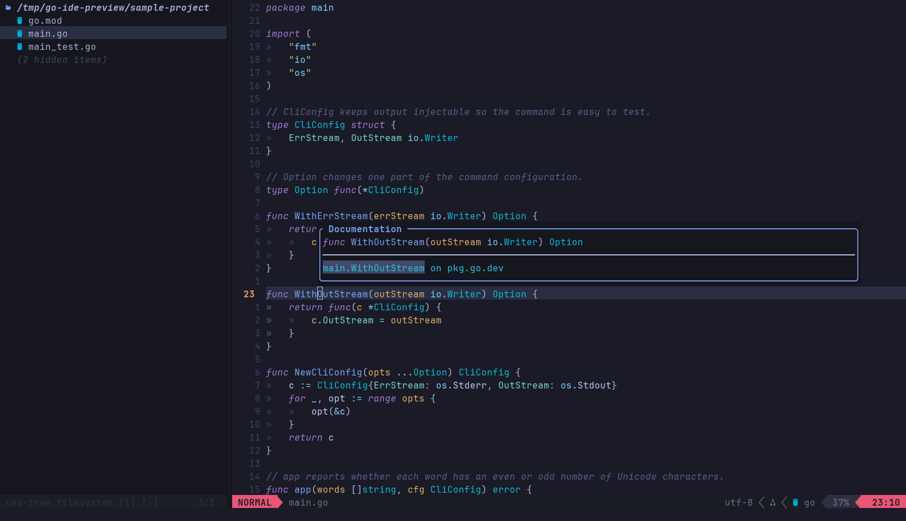

# Go IDE for Neovim

## Getting started

This setup combines the appearance of your current Neovim screenshots with a complete Go IDE workflow. It uses a navy editor, darker Neo-tree Explorer, lavender text, italic purple keywords, green strings, blue functions, teal types, amber parameters, and cyan Go gophers. The Horizon powerline status line uses rose accents in Normal mode and cyan in Insert mode at both ends of the bar. Your terminal supplies the font.

Relative line numbers and subtle tab guides make the editor familiar. File tabs appear when several files are open. Breadcrumbs and the minimap start hidden and can be shown when useful. Search, diagnostics, testing, debugging, Git, and the bottom terminal/output area remain available in this compact layout.

Go language features come from `gopls`, completion from `nvim-cmp`, formatting and import management from `goimports`, and debugging from Delve through Neovim's debug adapter plugins. These are installed and configured together. You do not need to configure a language server manually.

The profile launches as **`nvim-go`**. Your ordinary `nvim` configuration remains separate.

## 1. Install on Fedora Asahi Remix

Open a normal terminal. Install the small set of system dependencies:

```bash
sudo dnf install git curl tar unzip gcc ripgrep wl-clipboard fontconfig
```

Clone the repository and install from its root directory:

```bash
git clone https://github.com/zaouldyeck/nvim-go-ide.git
cd nvim-go-ide
bash install.sh --font
```

If you already cloned the repository, use that checkout. A complete downloaded ZIP also works: extract it, open the directory containing `install.sh`, and run the installer there.

An internet connection is needed for the first installation. The installer downloads the pinned Neovim release, installs Go development tools, installs plugins, and compiles syntax parsers. It checks release archives against the supplied SHA-256 values. It chooses native ARM64 binaries on an Asahi machine; it does not use x86 emulation.

From the same package directory, check the finished installation:

```bash
bash scripts/check.sh ~/.local/bin/nvim-go
```

This checks the installed tools, plugins, syntax parsers, and profile commands, and reports a failure if a required component is missing. It does not reinstall or update the profile.

If a matching Go 1.27 toolchain is unavailable, the installer supplies a private one for this IDE. Add `--install-go` to force the private toolchain even when a suitable system Go already exists:

```bash
bash install.sh --font --install-go
```

The private toolchain is put on `PATH` by the `nvim-go` launcher and is inherited by its integrated terminal. Your regular external terminal keeps its existing Go installation. For projects that require a particular compiler, inspect `go version` both inside and outside the IDE and respect the project's `go.mod` and toolchain requirements.

To inspect prerequisites and destination paths first:

```bash
bash install.sh --check
```

### Select the font

The `--font` option installs **JetBrainsMono Nerd Font Mono**. Select that exact family in your terminal's font preferences, then reopen the terminal if necessary. Start around 12–14 points and adjust for your display. The patched font supplies file, folder, and debugger icons; merely installing it does not change the active terminal font.

In **GNOME Terminal**, use Preferences → your profile → Text → Custom font. Other GNOME terminal applications may arrange their preferences differently. Font size, line spacing, transparency, and the outer window decorations belong to the terminal, so they are not controlled by this Neovim profile. [GNOME font documentation](https://help.gnome.org/gnome-terminal/app-fonts.html)

### Start the IDE

From the repository or extracted package directory:

```bash
cd sample-project
~/.local/bin/nvim-go main.go
```

If `~/.local/bin` is already on your `PATH`, `nvim-go main.go` is equivalent. The full path works without editing your shell configuration. To open your existing project:

```bash
cd ~/code/golang/cli
~/.local/bin/nvim-go .
```

Start from the project directory so Explorer, search, terminal commands, and project launch configurations share the same working directory. Open a Go file and let `gopls` finish its first indexing pass. Large modules may need a moment.

Run `:GoIdeHealth` inside Neovim to check the profile. In Neovim, a command such as `:GoIdeHealth` means: press `Esc`, type the colon and command, then press `Enter`.

## 2. The essential Neovim controls

Start with three modes:

| Mode | What it does | How to enter it |
| --- | --- | --- |
| Normal | Navigate and invoke editing commands | `Esc` |
| Insert | Type ordinary text | `i`; use `a` to insert after the cursor |
| Visual | Select text for an operation | `v`; use `V` for whole lines |

The status line shows the current mode in an uppercase coloured segment: rose **NORMAL** or cyan **INSERT**, with a matching position segment on the right. Arrow keys and the mouse work, so you can learn the keyboard motions gradually. The highlighted line number is your actual file line; surrounding numbers show the distance from it. In Normal mode, `5j` moves five lines down and `5k` moves five lines up. `Space u n` switches between relative and absolute numbering.

| Action | Keys or command |
| --- | --- |
| Save current file | `Ctrl+S`, or `:w` |
| Save all modified files | `:wall` |
| Save and quit | `:wq` |
| Close the current window | `:q` |
| Quit all windows after saving everything | `:wqa` |
| Undo / redo | `u` / `Ctrl+R` in Normal mode |
| Copy a line / paste | `yy` / `p` |
| Delete a line | `dd` |
| Change the word under the cursor | `ciw`, then type and press `Esc` |
| Search within the file | `/text`, `Enter`; `n` / `N` for next / previous |
| Go to a line | `:42` |
| Comment the current line | `gcc` |
| Comment selected lines | Select with `V`, then `gc` |
| Move between splits | `Ctrl+W`, then `h`, `j`, `k`, or `l` |

The **leader** key is `Space`. A shortcut written `Space f f` means press those keys in sequence while in Normal mode. Pause after `Space` to see available groups. Keep `SHORTCUTS.md` nearby for the full mapping reference.

For a guided introduction to Neovim's editing model, run `:Tutor`. Your normal project files are not needed for the tutorial.

## 3. Your first ten minutes with the sample project

The sample is a small CLI using functional options, similar in structure to the code in your screenshots. It reports each word's rune count and whether that count is odd or even. Its tests include an accented Swedish word and an output-error case.

### Read and navigate

Open `main.go`. Put the cursor on `NewCliConfig` or `io.Writer`, then press `K` to read documentation. Use `gd` or `F12` to jump to a definition and `Ctrl+O` to return to your earlier position. `Space o` opens the symbol outline. Turn on the breadcrumb line with `Space u b` to see the symbol you are editing; press the same keys again to hide it.

Open `main_test.go` using `Ctrl+P` or `Space f f`. `Space e` toggles Explorer. With two files open, the top buffer strip appears, much like VS Code's open-file tabs. It hides again when only one file remains. In Normal mode, `Tab` and `Shift+Tab` switch between open files, whether the strip is visible or hidden.

### Read hover documentation

Place the cursor on a Go symbol and press `K`. The documentation card has a rounded blue border and a **Documentation** title. It keeps the native Markdown formatting and highlighted Go signatures supplied through `gopls`. The card wraps long text and sizes itself to the available editor space.

Press `K` again to focus the card. Use `j` / `k` or `Ctrl+D` / `Ctrl+U` to scroll, then `q` or `Esc` to close it and return to the source. If you have not focused the card, moving the source cursor dismisses it. While typing a function call in Insert mode, `Ctrl+K` opens matching **Signature** help with the active parameter highlighted.



### Try completion and automatic imports

Inside a function, begin typing a standard-library symbol such as `strings.ToUpper`. Select a completion, accept it, and finish a valid expression. Saving runs `goimports`, which formats Go code and adds or removes imports when it can resolve them. Use `:GoImports` or `:GoFormat` to request the same formatting explicitly.

Use `Tab` and `Shift+Tab` to move through completion choices; `Ctrl+N` and `Ctrl+P` also navigate completion items. `Enter` accepts an item you selected. `Ctrl+Space` requests completion explicitly when your terminal forwards that chord. `Ctrl+L` and `Ctrl+H` provide dedicated snippet expansion/navigation without using Tab's completion selection behavior.

The buffer must contain syntactically valid Go for the formatter to succeed. If you are halfway through an expression, finish it first; a formatting failure should not be mistaken for a language-server failure.

### Use your snippets and argument placeholders

In a Go buffer, type a trigger and press `Ctrl+L` to expand it. You can also select its **Snippet** entry in completion and press `Enter`. Your original templates are available as `tys` (also `struct`), `meth`, `func`, and `fmain` (also `main`). The existing `iferr`, `test`, `forr`, `iface`, `switch`, and `errf` templates remain available.

| Action | Keys | When it applies |
| --- | --- | --- |
| Expand a trigger or jump forward | `Ctrl+L` | Insert or snippet Select mode |
| Jump to the previous field | `Ctrl+H` | Insert or snippet Select mode |
| Next / previous return form | `Alt+N` / `Alt+P` | While a snippet choice is active |
| Completion selection, then snippet navigation | `Tab` / `Shift+Tab` | Select completion items first while the menu is open; otherwise expand/jump through fields |

For `func` and `meth`, the return choice starts as `(T1, error)`. Change it with `Alt+N` to a single `error`, then to no return value, and then back to multiple returns. `Alt+P` cycles in the other direction. Type over `T1` or `error` to use another type. Receiver types in `meth` are editable, so use either `MyStruct` or `*MyStruct` as appropriate. `tys` and `struct` guide you through the struct name, first field name, and first field type before the remaining body.

Try a function with two return values:

1. On a new top-level line in a Go file, type `func`, then press `Ctrl+L`.
2. Replace `FunctionName` with `Load`. Press `Ctrl+L` and enter `path string` as the parameters.
3. Press `Ctrl+L` to reach `T1` in the default return form. Replace it with `string`.
4. Press `Ctrl+L` to reach `error`; leave it as-is. Press `Ctrl+L` again to reach the body and enter `return path, nil`.
5. Press `Esc`, then save. The result is:

```go
func Load(path string) (string, error) {
	return path, nil
}
```

For a no-return function, cycle the return choice until it is empty, then jump to the body. The templates help build the declaration; you still supply a body and return statements appropriate to the types you chose.

**Snippet jumps require active placeholders.** Accepting a gopls function completion can create fields for the call's arguments; `Ctrl+L` advances through those fields and `Ctrl+H` goes back. Reopening an ordinary call or moving into code that was already written does not create a snippet session. Use normal editing motions for that code, and `Ctrl+K` in Insert mode to display its signature. Also, the parameters field in the custom `func` template is one editable field: it does not automatically create a separate jump position for each parameter you type.

Outside an available snippet expansion/jump or choice, the dedicated keys fall back to their normal behavior. In Normal mode, `Ctrl+H` and `Ctrl+L` continue to move between windows. Some terminals encode Backspace as `Ctrl+H`; use Tab/Shift+Tab with completion closed if that causes a conflict. If `Alt+N`/`Alt+P` are intercepted by your desktop, terminal, or tmux, configure that layer to pass the keys through to Neovim.

### Edit and reload personal snippets

The source module is `config/lua/custom/snippets.lua` in the repository. With default paths, the installed copy is `~/.config/nvim-go/lua/custom/snippets.lua`. Edit the installed file for an immediate local change, save it, then run:

```vim
:GoSnippetsReload
```

Reloading updates the registered templates without duplicating completion entries. Start a fresh snippet expansion to try a changed template. Keep lasting edits in the repository copy too, because reinstalling replaces the installed configuration with the checkout's files. To locate your actual profile configuration when using custom XDG paths, run `:echo stdpath('config')`.

### Follow an error

Temporarily change a valid identifier to an undefined name. After `gopls` updates, the editor marks the problem. `Space x x` opens Problems; `Space x n` moves to the next diagnostic and `Space x d` shows the current line's message. Undo the edit and save.

Diagnostics include type errors and configured analysis findings. They are separate from test results: a project can type-check while one of its tests still fails. [Gopls diagnostics](https://go.dev/gopls/features/diagnostics)

### Rename a symbol

Place the cursor on `NewCliConfig` and press `F2` or `Space r n`. Enter a new name. `gopls` updates references across the relevant project files. Use `:wall` to save all the edits and inspect your Git diff afterward, just as you would after a refactor in VS Code.

Code actions are context-sensitive. On an appropriate expression or selection they can offer operations such as implementing an interface, filling a struct literal, extracting a function, or adding/removing struct tags. Press `Space c a` to see what is available at that location in a Telescope dropdown. Type to filter, select an action with the arrow keys or `Ctrl+J`/`Ctrl+K`, then press `Enter`; `Esc` cancels. [Gopls transformations](https://go.dev/gopls/features/transformation)

### Run the CLI

With `main.go` active:

```vim
:GoRun
```

The default output describes `hello`, `gopher`, and `Stockholm`. To pass simple arguments:

```vim
:GoRun gopher räka
```

This runs the **current package**, including its other Go files. The bottom terminal supports programs that read from standard input. For shell redirection, pipelines, complex quoting, or temporary environment variables, open the integrated shell and run an ordinary shell command, such as `go run . < input.txt`.

### Run and inspect tests

In `main_test.go`, place the cursor inside `TestApp` and run:

```vim
:GoTest nearest
```

Use `:GoOutput` to reopen the output. Then run the whole current module:

```vim
:GoTest all
```

To practise failure navigation, temporarily change one expected test string, save, and rerun the test. Failure locations are collected in the quickfix list; open it with `:copen`, press `Enter` on a location, and use `:cnext` / `:cprevious` to move through entries. Undo the intentional failure and rerun until the suite passes.

### Debug a test or the CLI

Open `main.go` and put the cursor on the executable line `length := len([]rune(word))` inside `app`. Press `F9` or `Space d b` to toggle a breakpoint, then `F5` or `Space d c` to start debugging. Select **Demo: Go CLI** or **Go: debug current package**.

When the program stops, inspect locals in **Scopes**. Press `Enter` to expand a value. `F10` / `Space d o` steps over, `F11` / `Space d i` steps into, and `F5` continues to the next breakpoint. In **Watches**, press `i`, type an expression such as `word`, and press `Enter`. The debugger evaluates it in the current stack frame. [Debugger UI controls](https://github.com/rcarriga/nvim-dap-ui#usage)

You can also position the cursor in a test and use `:GoDebugTest` or `Space d r`. `Space d t` stops debugging. `Space d u` shows or hides its panels; the output remains available after a session ends.

## 4. Daily project workflow

### Files, buffers, and splits

Use `Space f f` for known filenames and `Space f g` to search project text. `Space f c` opens the command palette. Explorer is useful for understanding directory structure and creating or renaming files. A **buffer** is an open file; a **window** is a view of a buffer. Two splits can display the same buffer, and closing one window does not necessarily close the file.

Your original search shortcuts are also available. Use `Space /` for a compact fuzzy search of the current buffer, `Space s w` to search the word under the cursor, and `Space s r` to resume the last picker. `Space s /` restricts text search to open buffers. `Space s n` finds files in the active Neovim profile, `Space s h` searches help, and `Space s k` finds key mappings. `Space Space` chooses an open buffer. The `Space s f`, `s g`, and `s .` aliases find files, search project text, and list recent files; existing `Space f ...` mappings remain unchanged.

The Neo-tree Explorer starts 40 columns wide. Its blue open-folder icon and bold italic path identify the current root, using `~` for your home directory. Dotfiles and ignored entries are filtered initially; a row such as **(2 hidden items)** reports the current count. Press `H` while Explorer is focused to show or hide filtered entries. Press `?` for its local help. `Enter` opens files or expands folders; `a` adds an item, `A` adds a directory, `r` renames, and `d` requests deletion with confirmation.

Keep one project per Neovim instance while learning the setup. To change project, save your work, quit, `cd` into the next project, and launch `nvim-go` again. This avoids accidentally running shell commands in an earlier working directory.

### Problems and output

The Problems panel collects language-server diagnostics. The Go output buffer holds the latest test/build output, with file locations available through quickfix. The debugger's REPL evaluates expressions in the paused program. The integrated terminal runs your shell. Choose the panel that matches the task; shell commands belong in Terminal, and debugger expressions belong in the debug REPL.

### Formatting, hints, and code actions

Formatting on save is enabled for Go files. `:GoFormatToggle` switches it for the current IDE session. `:GoInlayHints` toggles parameter/type hints, which start off to preserve the uncluttered screenshot style. `Space c l` runs an available code-lens action at the cursor; `:GoCodeLens` toggles the displayed lenses.

For module maintenance, use `Space c m` or `:GoModTidy` from a Go file, `go.mod`, or `go.sum`. It runs `go mod tidy` asynchronously in that file's nearest module and sends output to the Go output panel. Before starting, it saves modified named Go buffers belonging to that module plus its open `go.mod` and `go.sum` buffers; nested modules are excluded. Afterward, it reloads metadata buffers that have no unsaved edits and preserves unsaved changes made while the task was running for you to review. Use `Space t o` / `:GoOutput` to return to the output, or `Space t s` / `:GoStop` to cancel the task. In a workspace it affects the active file's module. Review the resulting `go.mod` and `go.sum` diff. Ordinary Go saves run formatting/import organization; they do not run module tidy.

Run, test, and debug actions save modified named Go buffers in the active module before executing. This helps ensure that the code being run includes recent edits and refactors. Use `:wall` explicitly when a change spans other file types or multiple modules.

### Tests and coverage

| Command | Scope |
| --- | --- |
| `:GoTest nearest` | The enclosing or preceding top-level test, including its subtests |
| `:GoTest file` | Tests declared in this file, with the whole package compiled |
| `:GoTest package` | Tests in the current package |
| `:GoTest all` | `./...` in the current Go module |
| `:GoCoverage` | Tests and coverage for the current Go module |
| `:GoCoverageClear` | Remove coverage marks from the editor |
| `:GoOutput` | Show the latest Go output |
| `:GoStop` | Stop the running Go task |

In a `go.work` workspace, `all` means the module containing the active file, not every module in the workspace. The test commands select top-level `Test`, `Example`, and `Fuzz` functions; they do not perform an indefinite fuzzing session or run benchmarks. For a specific subtest, benchmarks, race detection, build tags, or custom flags, use normal `go test` commands in the integrated terminal.

### Git

Changed lines have gutter markers. Use the Git shortcuts to preview or stage a hunk, inspect blame, and view diffs. Review a hunk before staging it. For your existing Git workflow, the integrated terminal remains available for `git status`, `git diff`, commits, branch changes, and rebases.

### The integrated terminal

Press `Space` followed by the backtick key to toggle your project shell, or use `:GoTerminal`. While typing in a terminal, keys go to the shell. Press `Esc` twice to return to Neovim's Normal mode; then use the window navigation keys or the terminal toggle. Press `i` to resume typing into a terminal. The native `Ctrl+\`, then `Ctrl+N` escape sequence also leaves terminal input mode.

The terminal runs your existing shell and prompt configuration. Changing directories there does not change the editor's project directory. A command such as `Ctrl+C` goes to the foreground terminal process when terminal input mode is active.

### Project-specific debugging

The debug adapter can read `.vscode/launch.json` from the working directory. The sample includes two Go configurations. For your own project, a basic launch entry can look like this:

```json
{
  "version": "0.2.0",
  "configurations": [
    {
      "name": "Go: API",
      "type": "go",
      "request": "launch",
      "mode": "debug",
      "program": "${workspaceFolder}/cmd/api",
      "args": ["--config", "dev.yaml"],
      "env": { "APP_ENV": "development" }
    }
  ]
}
```

Adjust the program directory and arguments to your repository. Standard Go launch fields are useful here, but VS Code extension commands and `tasks.json`/`preLaunchTask` workflows are not automatically reproduced. VS Code workspace settings are not imported: put required environment variables in the launch entry's `env`, or export them before starting the IDE. Use plain JSON for the most predictable compatibility. [nvim-dap-go launch configurations](https://github.com/leoluz/nvim-dap-go#vscode-launch-config)

Delve supports native Linux ARM64, including the architecture used by Fedora Asahi. Debugging a process you launch is the normal workflow. Attaching to an unrelated process can be restricted by operating-system permissions. For terminal-interactive programs, use `:GoRun` for normal execution; debugger stdin requirements may need a custom terminal or attach configuration. [Delve FAQ](https://github.com/go-delve/delve/blob/master/Documentation/faq.md)

## 5. Adjust the appearance

Press `Space u s` or run `:GoIdeSettings`, edit the preferences, and restart the IDE. With standard XDG paths, the settings file is:

```text
~/.config/nvim-go/lua/go_ide/settings.lua
```

The file groups the common preferences: Explorer width, automatic Explorer, status-line theme, hover size and border, breadcrumbs, file tabs, minimap visibility, relative line numbers, format-on-save, inlay hints, terminal height, icons, and the screenshot-derived colour palette.

The main appearance defaults are:

```lua
relative_numbers = true,
explorer_width = 40,
statusline_theme = 'horizon',
breadcrumbs = false,
minimap = false,
always_show_tabs = false,
hover_border = 'rounded',
hover_max_width = 100,
hover_max_height = 24,
```

Set `relative_numbers = false` for absolute numbering throughout. Set `breadcrumbs = true` to show the current-symbol path from startup, or toggle it for the current session with `Space u b` / `:GoIdeBreadcrumbs`. Set `always_show_tabs = true` to keep the file strip visible even with one file open. Set `icons = false` for the plain-text fallback.

Use `Space m m` to show or hide the minimap for the current session; set `minimap = true` to enable it from startup. An enabled minimap appears only when the terminal is wide enough. It uses terminal cells, so its detail differs from VS Code's pixel minimap.

The Horizon status-line theme supplies the rose Normal accent (`#e95678`) and cyan Insert accent (`#25b2bc`). Hover width and height are maximums in terminal cells. The card also caps itself to a fraction of the current editor size, so it remains usable in smaller windows.

The terminal renders the final font and spacing. If the colours match but the layout feels different, adjust the terminal font size and available columns before changing the Lua theme. Your shell also controls its own prompt, including the coloured path and prompt symbol visible in your screenshot.

## 6. Updates, backups, and removal

The package pins its tool versions in `scripts/versions.env` and plugin revisions in `lazy-lock.json`. This is a reproducible starting point. Normal editing does not require redownloading plugins once installation has completed; Go may still need network access when a project adds dependencies or requests a different toolchain.

The repository checkout and the installed profile are separate copies. To update, save your files and close all `nvim-go` sessions. Preserve changes you made in the checkout before pulling, and keep any installed settings or custom snippets you want to carry over. Then run these commands from the repository root:

```bash
git pull --ff-only
bash install.sh
bash scripts/check.sh ~/.local/bin/nvim-go
```

Pulling alone does not update the active profile. Reinstalling applies the checkout's configuration and pinned tooling, while moving the existing `nvim-go` configuration and launcher to timestamped backups. It does not merge personal edits. Reapply those edits selectively from the backup paths printed by the installer, especially `lua/custom/snippets.lua` and `lua/go_ide/settings.lua`. Add `--font` when the optional font also needs installing. The installer leaves the repository checkout in place.

If you originally installed from a ZIP, clone the repository as described in section 1 and run its installer. A downloaded release archive also works: extract the complete archive and run `bash install.sh` from the directory containing it. Retain a known-good commit or package for rollback.

For routine inspection, `:Lazy` opens the plugin manager. Avoid indiscriminately updating every plugin during your first week; the delivered revisions were selected and tested together. If you choose to experiment, back up the installed configuration and lockfile first. `:Lazy restore` restores the revisions recorded in the active lockfile.

To recover settings after a reinstall, close all `nvim-go` sessions. Rename the current profile directory, then restore the **exact backup path printed by your installer**, for example:

```bash
mv ~/.config/nvim-go ~/.config/nvim-go.after-install
mv ~/.config/nvim-go.backup-20261020-190000-12345 ~/.config/nvim-go
```

The timestamp above is illustrative; use your actual backup name. Restoring configuration alone does not roll back tool binaries or plugin data. To return to an older complete release, install a checkout or archive of that revision, restore your desired settings, and restore its lockfile revisions.

Default locations are:

| Content | Location |
| --- | --- |
| Configuration and bundled documentation | `~/.config/nvim-go` |
| Plugins, parsers, private tools, and downloads | `~/.local/share/nvim-go` |
| State and logs | `~/.local/state/nvim-go` |
| Cache | `~/.cache/nvim-go` |
| Launcher | `~/.local/bin/nvim-go` |

`XDG_CONFIG_HOME`, `XDG_DATA_HOME`, `XDG_STATE_HOME`, or `XDG_CACHE_HOME` can change their respective base directories. The installer prints the configuration and data paths it uses. Neovim's `NVIM_APPNAME` mechanism separates these profile directories. [Neovim startup documentation](https://neovim.io/doc/user/starting/#standard-path)

To stop using this profile, launch ordinary `nvim` again. To remove it, close its sessions and remove the profile-specific directories and launcher listed above after keeping anything you need. The optional font lives separately in your user's fonts directory.

## 7. Troubleshooting

### The shell says `nvim-go: command not found`

Use `~/.local/bin/nvim-go`. Add `~/.local/bin` to your shell's `PATH` later if you want the shorter command. The installer deliberately leaves your shell startup files alone.

### Icons are squares, missing, or too wide

Select **JetBrainsMono Nerd Font Mono** in the terminal, then open a fresh terminal window. Check the exact family rather than selecting the unpatched JetBrains Mono font. Alternatively, turn off icons in `settings.lua`.

### Copy/paste does not reach other applications

On a local Wayland desktop, check that `wl-copy` and `wl-paste` exist and that the terminal inherited `WAYLAND_DISPLAY`. Run `:checkhealth vim.provider`. Neovim uses an external clipboard provider; `wl-clipboard` supplies it on Wayland. [Neovim clipboard documentation](https://neovim.io/doc/user/provider/#clipboard)

### Completion or navigation is missing

Open a `.go` file in a directory containing a valid `go.mod` or `go.work`. Run `:GoIdeHealth`, check that the Go tools are present, and try `:GoLspRestart`. Confirm that `go list ./...` works in the project terminal. Authentication, proxy, private-module, or module-download failures can prevent `gopls` from loading a package.

### A file is missing from Explorer, or hover will not scroll

Focus Explorer and press `H` to reveal filtered files, including dotfiles and ignored entries; the hidden-item count explains when filtering is active. For documentation, press `K` a second time before scrolling. `j` / `k` and `Ctrl+D` / `Ctrl+U` then act inside the card. Press `q` or `Esc` there to close it.

### A shortcut does nothing

Press `Esc` and try the documented `Space` mapping. Some desktop and terminal shortcuts never reach Neovim, and traditional terminal encodings cannot distinguish every Ctrl/Shift combination. Function keys may require `Fn` or a keyboard mode change. Use the leader alternative or the explicit `:Go...` command. [Neovim terminal input documentation](https://neovim.io/doc/user/tui/#tui-input)

For snippet navigation, stay in Insert or snippet Select mode. Type a known trigger such as `func` and try `Ctrl+L`; an existing function call only supports jumps if its snippet placeholders are still active. Tab chooses completion items while the menu is open, so use the dedicated Ctrl keys for snippet navigation. If the new templates are missing after an update, confirm you reran the installer and restarted the profile; use `:GoSnippetsReload` after local template edits. Check terminal/tmux passthrough if only the Alt choice keys fail.

### Colours look washed out, or tabs, breadcrumbs, or the minimap are missing

Use an opaque terminal background and true-colour-capable terminal. Check terminal or tmux configuration if colours differ. The file strip is hidden with one file open by default; open a second file or set `always_show_tabs = true`. Breadcrumbs start hidden; press `Space u b` to show them. The minimap also starts hidden; press `Space m m`, then widen the window or reduce the font size if it still lacks the configured number of columns.

### A download or parser build failed

Read the first error from the installer. Verify internet access and the listed prerequisites, including a C compiler, then rerun the installer. Do not use `--skip-plugins` as a repair: that option deliberately leaves the IDE incomplete. Keep the terminal output if a proxy or network policy blocks a particular host.

### Tests or debugging run the wrong code

Check the active Go file, `:pwd`, the nearest `go.mod`, and any `.vscode/launch.json` selection. Save cross-module changes with `:wall`. Confirm the command works in the integrated terminal before investigating editor integration. Stop an existing debug session before starting a different launch configuration.

### Where do I look first?

Run `:GoIdeHealth`, then `:messages` for recent errors. `Space u h` or `:GoIdeGuide` opens this guide inside the editor. The profile's Lua files and the commands in `SHORTCUTS.md` are the reference for its actual behaviour. For Neovim itself, use `:help` followed by the feature name.
